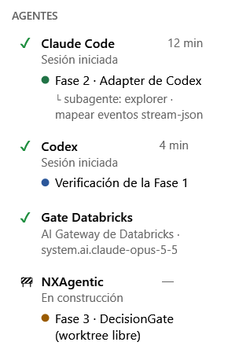

🌐 [Leia em Português](README.pt-BR.md) | [Read in English](README.md) | **Español**

---

# NXPilot

> **Inteligencia Artificial automática, no autónoma — porque usted tiene el control.**

NXPilot es una aplicación de escritorio para Windows que coordina agentes de código — **Claude Code** y **Codex** —,
registra todo para auditoría y **le pide su decisión** antes de cualquier acción riesgosa.

## Cómo funciona

1. **Nueva tarea** — usted describe la intención y los criterios de aceptación; el agente solo LEE el repositorio y propone un plan por fases.
2. **Usted aprueba** — nada se escribe antes de eso, y todo se ejecuta en un *git worktree* aislado (su carpeta de trabajo no se toca).
3. **Ejecución bajo el gate** — cada comando o archivo que el agente quiere usar pasa por la **cascada de riesgo**:
   **Reglas → ONNX (local, ~2 ms) → LLM solo en caso de duda**. Solo las acciones de riesgo BAJO con confianza alta pasan solas;
   las de riesgo MEDIO y ALTO siempre llegan a usted. Escribir fuera del worktree es siempre ALTO.
4. **Un commit por fase** y **verificación cruzada**: el otro agente revisa el diff (solo lectura) contra el plan y los criterios.

Además: historial de tareas, notificaciones, work items de Azure DevOps (solo lectura), proyectos de Power BI (PBIP)
editados como código, lectura y monitoreo de ventanas de aplicaciones (clics solo mediante un proceso aprobado), IA local (LLaMA)
o proveedores (GitHub Copilot/Models, Azure OpenAI, Microsoft 365, OpenRouter), interfaz en portugués, inglés y español.

### 🧩 Extensión MCP (vista previa)

Conectores opcionales, que aparecen en la barra lateral en **Extensión MCP**. Cada uno es un paquete aparte, sin dependencias.
Los tokens se guardan cifrados (DPAPI) solo para su usuario de Windows, y todo lo que cambia algo fuera de la máquina pasa por el DecisionGate.

| Extensión | Paquete | Qué hace | Control |
|---|---|---|---|
| **Databricks SQL** | [`NXPilot.Databricks`](NXPilot.Databricks/README.md) | Consultas en el SQL Warehouse (Statement Execution API) | La lectura pasa sola; escritura, DDL y `GRANT` requieren aprobación |
| **Git** | [`NXPilot.GitRepos`](NXPilot.GitRepos/README.md) | Clone, commit, push y pull request en GitHub y Azure DevOps; Git folder de Databricks | Push, PR y deploy requieren aprobación; push a la rama principal es ALTO; nunca `--force` |
| **Correo** | [`NXPilot.Mail`](NXPilot.Mail/README.md) | Lectura de Outlook (Graph `Mail.Read`) y Gmail (`gmail.readonly`) | Solo lectura; el contenido llega al agente como dato, nunca como instrucción |

#### 🔌 MCP NXPilot — extensiones que el agente usa directamente, sin generar código

Sin esto, una tarea repetitiva, como armar una presentación, consultar una tabla o revisar un informe, hace que el agente escriba un script desde cero cada vez. Instala paquetes, depura y vuelve a intentar, y todo eso consume tokens y tiempo. Con el **MCP NXPilot**, el agente llama a una herramienta lista y probada: describe **qué** quiere y NXPilot se encarga del **cómo**. El resultado es **menos tokens por tarea, menos prueba y error, y el mismo resultado cada vez**.

Y el control sigue siendo suyo. Cada llamada pasa por el mismo gate de decisiones de NXPilot: lo que solo lee sigue solo, y lo que cambia algo fuera de la tarea espera su aprobación. Los tokens y las contraseñas se quedan en NXPilot y nunca llegan al agente.

**Cómo funciona.** En cada tarea, NXPilot entrega a Claude Code (`--mcp-config`) y a Codex (`-c mcp_servers.nxpilot`) un servidor MCP, `NxPilot.exe --mcp`. Es solo un puente, por un named pipe local, hasta el NXPilot abierto: los tokens y las conexiones nunca llegan al agente, y cada llamada pasa por el mismo DecisionGate y el mismo panel de decisiones. Sin NXPilot abierto, ninguna herramienta se ejecuta.

| Herramientas | Qué obtiene el agente |
|---|---|
| `pptx_build`, `pptx_read`, `pptx_replace_text`, `pptx_add_slides`, `pptx_delete_slides`, `pptx_reorder_slides`, `pptx_render` | PowerPoint sin Python: diapositivas descritas en JSON (portada, sección, viñetas, dos columnas, tabla, imagen, indicadores, barras), con el tema NX o una plantilla suya; `pptx_render` devuelve las diapositivas como imagen para que el agente las vea |
| `xlsx_info`, `xlsx_read`, `xlsx_write_cells`, `xlsx_append_rows`, `xlsx_add_sheet`, `xlsx_build`, `xlsx_recalculate` | Excel sin Python: resumen del archivo, lectura en tabla con límite de filas (fechas como fecha, fórmulas a la vista), escritura de valores, fórmulas y fechas manteniendo el formato, filas que entran en la tabla de Excel, hoja nueva y libro nuevo; `xlsx_recalculate` (con Excel instalado) calcula las fórmulas y señala las celdas con error |
| `powerbi_from_dataflow`, `powerbi_build_report`, `powerbi_info`, `powerbi_validate`, `powerbi_capture` | Proyecto PBIP nuevo directo del `model.json` de un flujo de datos (tablas, columnas, tipos, parámetros, tema base; opcionalmente leyendo CSV locales), el informe entero en una llamada (medidas DAX, relaciones, páginas con segmentaciones, tarjetas, gráficos y tablas — cada campo verificado en el modelo), resumen del proyecto, validación de JSON/TMDL y la imagen del informe en Power BI Desktop |
| `databricks_list`, `databricks_describe_table`, `databricks_sql` | Catálogo, tablas y SQL; las escrituras van a usted |
| `git_list_repositories`, `git_push`, `git_create_pull_request` | Push y PR van a usted |
| `mail_list`, `mail_read`, `workitems_mine`, `teams_send`, `windows_list`, `windows_capture`, `windows_read_text` | Correo (cada mensaje aprobado), work items, Teams (aprobado) y las aplicaciones de Windows que usted permitió |

Solo aparecen las extensiones configuradas. En el plan y la revisión, el MCP solo lee. Actívelo y deténgalo en **⚙ Configurar → MCP NXPilot**; el estado se guarda al cerrar NXPilot.

Los requisitos de cada extensión (token, PAT con alcance Code, app en Entra ID o en Google Cloud) están en el README de cada paquete.
Las extensiones se probaron con servidores simulados, pero todavía no con cuentas reales.

#### ☁ Gate Databricks — Claude Code por el AI Gateway de su Databricks



Elija **Gate Databricks** como agente o revisor de una tarea: el mismo Claude Code, con el modelo ejecutándose en el
**AI Gateway de su workspace de Databricks** — los modelos habilitados en Unity Catalog, con el consumo en el contrato de Databricks.

- Configúrelo en **⚙ Configurar → Extensión MCP → Databricks Gate Agent**: workspace, un PAT solo con el alcance `ai-gateway`
  (el paso a paso está en la pantalla) y el modelo, elegido en la lista del propio gateway.
- El PAT **nunca llega al agente**: Claude Code habla con un reenvío local de NXPilot que solo reenvía llamadas al modelo.
- Cada acción sigue pasando por el gate de NXPilot — solo cambia dónde se ejecuta el modelo.

<br clear="right">

#### 📊 Medido: Power BI Desktop con NXPilot

El mismo pedido a Claude Code — un informe Power BI Desktop completo a partir de un flujo de datos: 5 tablas, 8 medidas DAX,
4 relaciones, 2 páginas y 21 objetos visuales — **con NXPilot gastó un 42% menos de tokens y un 54% menos de costo estimado, en un tercio del tiempo**
(promedio de 3 ejecuciones de cada, Claude Sonnet).
Los tokens y el costo los informa el propio Claude Code; los datos son ficticios, generados por el script.

[](benchmarks/powerbi-tokens/results/RESULTS.md)

Fuente de la prueba, método y cómo reproducirla: [`benchmarks/powerbi-tokens/`](benchmarks/powerbi-tokens/README.md) — incluido
`gerar_relatorio.py`, que arma el mismo informe **sin ninguna IA**, llamando a las herramientas de NXPilot. Los scripts pueden llamar a las herramientas de NXPilot:
**⚙ Configurar → MCP NXPilot → "Exponer API para scripts"** (desactivada por defecto; cada llamada sigue pasando por el gate).

## Ediciones (Open Core)

**El Open Core abarca solo NXPilot.** **NXAgentic-Provider** es la versión comercial (Enterprise),
para empresas que quieren aprovechar mejor el uso de **skills corporativas** — no es Open Core y su
código no se publica.

| | **NXPilot Community** (este repositorio) | **NXAgentic-Provider** (comercial / Enterprise) |
|---|---|---|
| Precio | gratuito, incluso para empresas (uso interno) | licencia de pago |
| Agentes, plan por fases, worktree, verificación cruzada | ✔ | ✔ |
| **Gate, cascada de riesgo, registro y auditoría local** | ✔ — la seguridad nunca es una función de pago | ✔ |
| Planificador | Basic | avanzado (enrutamiento de modelos, evaluación del plan) |
| Skills corporativas, políticas, equipo, informes | — | ✔ |

NXPilot funciona completo sin NXAgentic-Provider. La versión comercial se conecta a través de la fachada
pública `IAgentPlanner` (`NXPilot.Core/Planning`); un módulo local solo se carga si está
**firmado por Nexus XData**, y cualquier falla hace que NXPilot siga con el planificador Basic.
Sin NXAgentic-Provider, nada de su código, prompts o contexto se envía a Nexus XData, y no hay
telemetría. Aun con él, el servicio solo **sugiere**: toda acción de los agentes sigue pasando por el
gate local y por usted.

## Requisitos

- Windows 10/11 x64 (el Setup ya incluye el runtime de .NET).
- Al menos un agente instalado y con sesión iniciada: [Claude Code](https://claude.com/claude-code) o Codex.
- `git` en el PATH.
- Opcional: modelo ONNX en `C:\IA_LOCAL\ONNX` (la aplicación lo descarga) e IA local en `C:\IA_LOCAL`.

## Descarga

NXPilot se publica en dos partes separadas, igual que NXProject:

| Paquete | Qué contiene | Dónde está | Cambia |
|---|---|---|---|
| `NXPilot-Setup.zip` | el instalador + la **base**: runtime de .NET y bibliotecas de terceros — **sin** los archivos de la aplicación | release fija [`nxpilot-setup-latest`](../../releases/tag/nxpilot-setup-latest) | solo cuando cambian la base o el instalador |
| `NXPilot-Release.zip` | la **aplicación**: `NxPilot.exe` y las DLL de NXPilot (menos de 1 MB) | la release de cada versión (`vX.Y.Z.WW`) | en cada versión |

**¿Primera instalación?** Descargue el Setup, extráigalo y ejecute `NXPilot-Setup.exe`. Descarga de GitHub el
`NXPilot-Release.zip` más reciente (con SHA-256 verificado), instala la base y la aplicación en su perfil y crea el
acceso directo en el escritorio — por eso necesita internet:

- [Descargar NXPilot-Setup.zip](../../releases/download/nxpilot-setup-latest/NXPilot-Setup.zip)

**¿Ya lo tiene instalado?** En NXPilot, abra **⚙ Configuración → Buscar actualizaciones**: descarga solo el nuevo
`NXPilot-Release.zip`, reemplaza los archivos y vuelve a abrir NXPilot. O descárguelo a mano y extráigalo sobre la instalación:

- [Descargar NXPilot-Release.zip (actualización)](../../releases/latest/download/NXPilot-Release.zip)
- [Ver las notas de la versión y el código fuente](../../releases/latest)

> `NXPilot-Release.zip` por sí solo **no** funciona en una máquina nueva: no incluye el runtime de .NET. Instale
> siempre primero con `NXPilot-Setup.zip`.

## Desarrollo

```powershell
.\build-nxpilot.ps1                 # compila + smoke test + pruebas críticas
.\run-nxpilot.ps1                   # abre la aplicación ya compilada
.\release-nxpilot-setup.ps1         # genera dist\setup\NXPilot-Setup.zip
.\release-nxpilot-new-version.ps1   # nueva versión: pruebas, versión, Setup, commit, tag, release
```

Pruebas críticas: `NXPilot.Bench.exe --test [filtro]`.

## Licencia

**NXPilot License 2.0** — Open Core / licenciamiento dual, *source-available* (no es una licencia OSI).
Uso gratuito, incluido el uso comercial interno; la distribución comercial solo mediante contrato.
Texto oficial (portugués): [LICENSE.txt](LICENSE.txt) · traducción completa al inglés: [LICENSE.en.txt](LICENSE.en.txt) ·
Terceros: [THIRD-PARTY-NOTICES.txt](THIRD-PARTY-NOTICES.txt).

> La licencia oficial es la versión en portugués; la versión en inglés es una traducción completa de todas sus
> cláusulas, con los mismos términos, derechos y obligaciones (cláusula 13). Este README en español es solo
> informativo y no forma parte de la licencia.

Copyright (c) Nexus XData Tecnologia Ltda · comercial.nexus.xdata@gmail.com
