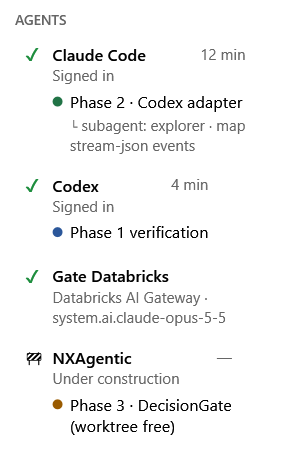

🌐 [Leia em Português](README.pt-BR.md) | **English** | [Leer en español](README.es.md)

---

# NXPilot

> **Automatic, not autonomous AI — because you are in control.**

NXPilot is a Windows desktop app that coordinates coding agents — **Claude Code** and **Codex** —
logs everything for auditing and **asks for your decision** before any risky action.

## How it works

1. **New task** — you describe the intent and the acceptance criteria; the agent only READS the repository and proposes a phased plan.
2. **You approve** — nothing is written before that, and everything runs in an isolated *git worktree* (your working folder is never touched).
3. **Execution under the gate** — every command or file the agent wants to use goes through the **risk cascade**:
   **Rules → ONNX (local, ~2 ms) → LLM only when in doubt**. Only LOW-risk actions with high confidence go through on their own;
   MEDIUM and HIGH always come to you. Writing outside the worktree is always HIGH.
4. **One commit per phase** and **cross-verification**: the other agent reviews the diff (read-only) against the plan and the criteria.

Also: task history, notifications, Azure DevOps work items (read-only), Power BI projects (PBIP) edited as code,
reading and monitoring app windows (clicks only through an approved process), local AI (LLaMA) or providers
(GitHub Copilot/Models, Azure OpenAI, Microsoft 365, OpenRouter), user interface in Portuguese, English and Spanish.

### 🧩 MCP Extension (preview)

Optional connectors, shown in the sidebar under **MCP Extension**. Each one is a separate package, with no dependencies.
Tokens are encrypted (DPAPI) for your Windows user only, and anything that changes something outside the machine goes through the DecisionGate.

| Extension | Package | What it does | Control |
|---|---|---|---|
| **Databricks SQL** | [`NXPilot.Databricks`](NXPilot.Databricks/README.md) | Queries on the SQL Warehouse (Statement Execution API) | Reads go through on their own; writes, DDL and `GRANT` require approval |
| **Git** | [`NXPilot.GitRepos`](NXPilot.GitRepos/README.md) | Clone, commit, push and pull request on GitHub and Azure DevOps; Databricks Git folder | Push, PR and deploy require approval; push to the main branch is HIGH; never `--force` |
| **E-mail** | [`NXPilot.Mail`](NXPilot.Mail/README.md) | Reads Outlook (Graph `Mail.Read`) and Gmail (`gmail.readonly`) | Read-only; content goes to the agent as data, never as instructions |

#### 🔌 MCP NXPilot — extensions the agent uses directly, without generating code

Without it, a repetitive job — building a presentation, querying a table, checking a report — makes the agent write a script from scratch every time: install packages, debug, try again. All of that costs tokens and time. With the **MCP NXPilot**, the agent calls a ready, tested tool instead: it describes **what** it wants and NXPilot does the **how**. The result is **fewer tokens per task, less trial and error, and the same result every time**.

And you stay in control: every call goes through NXPilot's decision gate. Reads go on their own; anything that changes something outside the task waits for your approval. Tokens and passwords stay in NXPilot and never reach the agent.

**How it works.** In every task, NXPilot gives Claude Code (`--mcp-config`) and Codex (`-c mcp_servers.nxpilot`) one MCP server, `NxPilot.exe --mcp`. It is only a bridge, through a local named pipe, to the NXPilot that is open: tokens and connections never reach the agent, and every call goes through the same DecisionGate and the same decisions panel. Without NXPilot open, no tool runs.

| Tools | What the agent gets |
|---|---|
| `pptx_build`, `pptx_read`, `pptx_replace_text`, `pptx_add_slides`, `pptx_delete_slides`, `pptx_reorder_slides`, `pptx_render` | PowerPoint without Python: slides described in JSON (title, section, bullets, two columns, table, image, KPIs, bars), NX theme or a template, and `pptx_render` returns the slides as images so the agent can look at them |
| `xlsx_info`, `xlsx_read`, `xlsx_write_cells`, `xlsx_append_rows`, `xlsx_add_sheet`, `xlsx_build`, `xlsx_recalculate` | Excel without Python: file summary, reading as a table with a row limit (dates as dates, formulas shown), writing values, formulas and dates while keeping the formatting, rows that join the Excel table, new sheet and new workbook; `xlsx_recalculate` (with Excel installed) calculates the formulas and points out the cells with errors |
| `powerbi_from_dataflow`, `powerbi_build_report`, `powerbi_info`, `powerbi_validate`, `powerbi_capture` | New PBIP project straight from a dataflow `model.json` (tables, columns, types, parameters, base theme; optionally reading local CSV files), the whole report in one call (DAX measures, relationships, pages with slicers, cards, charts and tables — every field checked against the model), project summary, JSON/TMDL validation, and a screenshot of the report in Power BI Desktop |
| `databricks_list`, `databricks_describe_table`, `databricks_sql` | Catalog, tables and SQL; writes go to you |
| `git_list_repositories`, `git_push`, `git_create_pull_request` | Push and PR go to you |
| `mail_list`, `mail_read`, `workitems_mine`, `teams_send`, `windows_list`, `windows_capture`, `windows_read_text` | E-mail (each message approved), work items, Teams (approved) and the Windows apps you allowed |

Only configured extensions are listed. Planning and review are read-only. Start and stop it in **⚙ Settings → MCP NXPilot**; the state is kept when NXPilot closes.

The prerequisites of each extension (token, PAT with Code scope, app in Entra ID or Google Cloud) are in each package's README.
The extensions were tested against simulated servers, but not yet with real accounts.

#### ☁ Gate Databricks — Claude Code through your Databricks AI Gateway



Pick **Gate Databricks** as the agent or the reviewer of a task: the same Claude Code, with the model running in the
**AI Gateway of your Databricks workspace** — the models enabled in Unity Catalog, usage under your Databricks contract.

- Set it up in **⚙ Settings → MCP Extension → Databricks Gate Agent**: workspace, a PAT with only the `ai-gateway` scope
  (the step-by-step is on the screen) and the model, from the gateway's own list.
- The PAT **never reaches the agent**: Claude Code talks to a local NXPilot relay that only forwards model calls.
- Every action still goes through the NXPilot gate — only where the model runs changes.

<br clear="right">

#### 📊 Measured: Power BI Desktop with NXPilot

The same request to Claude Code — a complete Power BI Desktop report from a dataflow: 5 tables, 8 DAX measures, 4 relationships,
2 pages and 21 visuals — **with NXPilot used 42% fewer tokens and 54% lower estimated cost, in a third of the time**
(average of 3 runs each, Claude Sonnet).
Tokens and cost are reported by Claude Code itself; the data is fictitious and generated by the script.

[](benchmarks/powerbi-tokens/results/RESULTS.md)

Test source, method and how to reproduce: [`benchmarks/powerbi-tokens/`](benchmarks/powerbi-tokens/README.md) — including
`gerar_relatorio.py`, which builds the same report **without any AI**, calling NXPilot's tools. Scripts can call NXPilot's tools:
**⚙ Settings → MCP NXPilot → "Expose API for scripts"** (off by default; every call still goes through the gate).

## Editions (Open Core)

**Open Core covers NXPilot only.** **NXAgentic-Provider** is the commercial (Enterprise) version,
for companies that want to make better use of **corporate skills** — it is not Open Core and its
code is not published.

| | **NXPilot Community** (this repository) | **NXAgentic-Provider** (commercial / Enterprise) |
|---|---|---|
| Price | free, including for companies (internal use) | paid license |
| Agents, phased plan, worktree, cross-verification | ✔ | ✔ |
| **Gate, risk cascade, local log and audit** | ✔ — security is never a paid feature | ✔ |
| Planner | Basic | advanced (model routing, plan evaluation) |
| Corporate skills, policies, team, reports | — | ✔ |

NXPilot works fully without NXAgentic-Provider. The commercial version plugs in through the public
`IAgentPlanner` facade (`NXPilot.Core/Planning`); a local module is only loaded if it is
**signed by Nexus XData**, and any failure makes NXPilot fall back to the Basic planner.
Without NXAgentic-Provider, none of your code, prompts or context is sent to Nexus XData, and there is
no telemetry. Even with it, the service only **suggests**: every agent action still goes through the
local gate and through you.

## Requirements

- Windows 10/11 x64 (the Setup already includes the .NET runtime).
- At least one agent installed and signed in: [Claude Code](https://claude.com/claude-code) or Codex.
- `git` on the PATH.
- Optional: ONNX model in `C:\IA_LOCAL\ONNX` (the app downloads it) and local AI in `C:\IA_LOCAL`.

## Download

NXPilot is published in two separate parts, the same way as NXProject:

| Package | What it has | Where it lives | Changes |
|---|---|---|---|
| `NXPilot-Setup.zip` | the installer + the **base**: .NET runtime and third-party libraries — **no** NXPilot app files | fixed release [`nxpilot-setup-latest`](../../releases/tag/nxpilot-setup-latest) | only when the base or the installer changes |
| `NXPilot-Release.zip` | the **app** itself: `NxPilot.exe` and the NXPilot DLLs (well under 1 MB) | each version's release (`vX.Y.Z.WW`) | every version |

**First time installing?** Download the Setup, extract it and run `NXPilot-Setup.exe`. It downloads the latest
`NXPilot-Release.zip` from GitHub (SHA-256 checked), installs the base and the app in your profile and creates the
desktop shortcut — so it needs internet access:

- [Download NXPilot-Setup.zip](../../releases/download/nxpilot-setup-latest/NXPilot-Setup.zip)

**Already installed?** In NXPilot, open **⚙ Settings → Check for updates**: it downloads only the new
`NXPilot-Release.zip`, swaps the files and restarts NXPilot. Or grab it by hand and extract it over your installation:

- [Download NXPilot-Release.zip (update)](../../releases/latest/download/NXPilot-Release.zip)
- [View release notes and source code downloads](../../releases/latest)

> `NXPilot-Release.zip` alone does **not** run on a new machine: it has no .NET runtime. Always install with
> `NXPilot-Setup.zip` first.

## Development

```powershell
.\build-nxpilot.ps1                 # build + smoke test + critical tests
.\run-nxpilot.ps1                   # open the already-built app
.\release-nxpilot-setup.ps1         # generate dist\setup\NXPilot-Setup.zip
.\release-nxpilot-new-version.ps1   # new version: tests, version, Setup, commit, tag, release
```

Critical tests: `NXPilot.Bench.exe --test [filter]`.

## License

**NXPilot License 2.0** — Open Core / dual licensing, *source-available* (not an OSI license).
Free to use, including internal commercial use; commercial distribution only under contract.
Official text (Portuguese): [LICENSE.txt](LICENSE.txt) · complete English translation: [LICENSE.en.txt](LICENSE.en.txt) ·
Third parties: [THIRD-PARTY-NOTICES.txt](THIRD-PARTY-NOTICES.txt).

> The official license is the Portuguese one. The English text is a complete translation that reproduces all of
> its clauses, with the same terms, rights and obligations; any difference stems from translation or
> interpretation, and in that case the Portuguese text prevails (clause 13).

Copyright (c) Nexus XData Tecnologia Ltda · comercial.nexus.xdata@gmail.com
