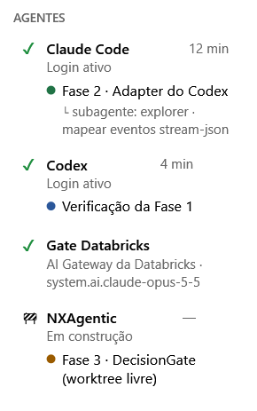

🌐 **Português** | [Read in English](README.md) | [Leer en español](README.es.md)

---

# NXPilot

> **Inteligência Artificial Automática, e não autônoma — porque você está no controle.**

O NXPilot é um app desktop (Windows) que coordena agentes de código — **Claude Code** e **Codex** —
registra tudo para auditoria e **pede a sua decisão** antes de qualquer ação arriscada.

## Como funciona

1. **Nova tarefa** — você descreve a intenção e os critérios de aceite; o agente só LÊ o repositório e propõe um plano em fases.
2. **Você aprova** — nada é escrito antes disso, e tudo roda num *git worktree* isolado (sua pasta de trabalho não é tocada).
3. **Execução sob o gate** — cada comando ou arquivo que o agente quer usar passa pela **cascata de risco**:
   **Regras → ONNX (local, ~2 ms) → LLM só na dúvida**. Só ações de risco BAIXO com confiança alta passam sozinhas;
   MÉDIO e ALTO sempre vêm para você. Escrever fora do worktree é sempre ALTO.
4. **Commit por fase** e **verificação cruzada**: o outro agente revisa o diff (somente leitura) contra o plano e os critérios.

Também: histórico de tarefas, notificações, work items do Azure DevOps (somente leitura), projetos Power BI (PBIP)
editados como código, leitura e monitoramento de janelas de apps (cliques só por processo aprovado), IA local (LLaMA) ou
provedores (GitHub Copilot/Models, Azure OpenAI, Microsoft 365, OpenRouter), interface em português, inglês e espanhol.

### 🧩 Extensão MCP (prévia)

Conectores opcionais, que ficam na barra lateral em **Extensão MCP**. Cada um é um pacote à parte, sem dependências.
Os tokens ficam cifrados (DPAPI) só no seu usuário do Windows, e o que muda algo fora da máquina passa pelo DecisionGate.

| Extensão | Pacote | O que faz | Controle |
|---|---|---|---|
| **Databricks SQL** | [`NXPilot.Databricks`](NXPilot.Databricks/README.md) | Consultas no SQL Warehouse (Statement Execution API) | Leitura passa sozinha; escrita, DDL e `GRANT` pedem aprovação |
| **Git** | [`NXPilot.GitRepos`](NXPilot.GitRepos/README.md) | Clone, commit, push e pull request no GitHub e no Azure DevOps; Git folder do Databricks | Push, PR e deploy pedem aprovação; push na principal é ALTO; nunca `--force` |
| **E-mail** | [`NXPilot.Mail`](NXPilot.Mail/README.md) | Leitura do Outlook (Graph `Mail.Read`) e do Gmail (`gmail.readonly`) | Somente leitura; o conteúdo vai ao agente como dado, nunca como instrução |

#### 🔌 MCP NXPilot — extensões que o agente usa direto, sem gerar código

Sem isso, uma tarefa repetitiva, como montar uma apresentação, consultar uma tabela ou conferir um relatório, faz o agente escrever um script do zero a cada vez. Ele instala pacotes, depura e tenta de novo, e tudo isso gasta tokens e tempo. Com o **MCP NXPilot**, o agente chama uma ferramenta pronta e testada: ele descreve **o que** quer, e o NXPilot faz o **como**. O resultado é **menos tokens por tarefa, menos tentativa e erro, e um resultado igual toda vez**.

E o controle continua com você. Cada chamada passa pelo mesmo gate de decisões do NXPilot: o que só lê segue sozinho, e o que altera algo fora da tarefa espera a sua aprovação. Tokens e senhas ficam no NXPilot e nunca chegam ao agente.

**Como funciona.** Em cada tarefa, o NXPilot entrega ao Claude Code (`--mcp-config`) e ao Codex (`-c mcp_servers.nxpilot`) um servidor MCP, o `NxPilot.exe --mcp`. Ele é só uma ponte, por um named pipe local, até o NXPilot aberto: tokens e conexões nunca chegam ao agente, e cada chamada passa pelo mesmo DecisionGate e pelo mesmo painel de decisões. Sem o NXPilot aberto, nenhuma ferramenta executa.

| Ferramentas | O que o agente ganha |
|---|---|
| `pptx_build`, `pptx_read`, `pptx_replace_text`, `pptx_add_slides`, `pptx_delete_slides`, `pptx_reorder_slides`, `pptx_render` | PowerPoint sem Python: slides descritos em JSON (capa, seção, tópicos, duas colunas, tabela, imagem, indicadores, barras), com o tema NX ou um modelo seu; o `pptx_render` devolve os slides como imagem para o agente olhar |
| `xlsx_info`, `xlsx_read`, `xlsx_write_cells`, `xlsx_append_rows`, `xlsx_add_sheet`, `xlsx_build`, `xlsx_recalculate` | Excel sem Python: resumo do arquivo, leitura em tabela com limite de linhas (datas como data, fórmulas à vista), escrita de valores, fórmulas e datas mantendo a formatação, linhas que entram na tabela do Excel, aba nova e planilha nova; o `xlsx_recalculate` (com o Excel instalado) calcula as fórmulas e aponta as células com erro |
| `powerbi_from_dataflow`, `powerbi_build_report`, `powerbi_info`, `powerbi_validate`, `powerbi_capture` | Projeto PBIP novo direto do `model.json` de um fluxo de dados (tabelas, colunas, tipos, parâmetros, tema base; opcionalmente lendo CSV locais), o relatório inteiro numa chamada (medidas DAX, relacionamentos, páginas com segmentações, cartões, gráficos e tabelas — cada campo conferido no modelo), resumo do projeto, validação de JSON/TMDL e a imagem do relatório no Power BI Desktop |
| `databricks_list`, `databricks_describe_table`, `databricks_sql` | Catálogo, tabelas e SQL; escrita vai para você |
| `git_list_repositories`, `git_push`, `git_create_pull_request` | Push e PR vão para você |
| `mail_list`, `mail_read`, `workitems_mine`, `teams_send`, `windows_list`, `windows_capture`, `windows_read_text` | E-mail (cada mensagem aprovada), work items, Teams (aprovado) e os apps do Windows que você liberou |

Só aparecem as extensões configuradas. No plano e na revisão, o MCP só lê. Ligue e pare em **⚙ Configurar → MCP NXPilot**; o estado fica guardado ao fechar o NXPilot.

Os pré-requisitos de cada extensão (token, PAT com escopo Code, app no Entra ID ou no Google Cloud) estão no README de cada pacote.
As extensões foram testadas com servidores simulados, mas ainda não com contas reais.

#### ☁ Gate Databricks — o Claude Code pelo AI Gateway da sua Databricks



Escolha o **Gate Databricks** como agente ou revisor de uma tarefa: o mesmo Claude Code, com o modelo rodando no
**AI Gateway do seu workspace Databricks** — os modelos liberados no Unity Catalog, com o consumo no contrato da Databricks.

- Configure em **⚙ Configurar → Extensão MCP → Databricks Gate Agent**: workspace, um PAT só com o escopo `ai-gateway`
  (o passo a passo está na tela) e o modelo, escolhido na lista do próprio gateway.
- O PAT **nunca chega ao agente**: o Claude Code fala com um repasse local do NXPilot, que só encaminha chamadas de modelo.
- Toda ação continua passando pelo gate do NXPilot — só muda onde o modelo roda.

<br clear="right">

#### 📊 Medido: Power BI Desktop com o NXPilot

O mesmo pedido ao Claude Code — um relatório Power BI Desktop completo a partir de um fluxo de dados: 5 tabelas, 8 medidas DAX,
4 relacionamentos, 2 páginas e 21 visuais — **com o NXPilot gastou 42% menos tokens e 54% menos custo estimado, em um terço do tempo**
(média de 3 rodadas de cada, Claude Sonnet).
Tokens e custo são informados pelo próprio Claude Code; os dados são fictícios, gerados pelo script.

[](benchmarks/powerbi-tokens/results/RESULTS.md)

Fonte do teste, método e como reproduzir: [`benchmarks/powerbi-tokens/`](benchmarks/powerbi-tokens/README.md) — inclusive o
`gerar_relatorio.py`, que monta o mesmo relatório **sem nenhuma IA**, chamando as ferramentas do NXPilot. Scripts podem chamar as ferramentas do NXPilot:
**⚙ Configurar → MCP NXPilot → "Expor API para scripts"** (desligada por padrão; toda chamada continua passando pelo gate).

## Edições (Open Core)

O **Open Core abrange somente o NXPilot**. O **NXAgentic-Provider** é a versão comercial (Enterprise),
para empresas que querem aproveitar melhor o uso de **skills corporativas** — não é Open Core e seu
código não é publicado.

| | **NXPilot Community** (este repositório) | **NXAgentic-Provider** (comercial / Enterprise) |
|---|---|---|
| Preço | gratuito, inclusive para empresas (uso interno) | licença paga |
| Agentes, plano em fases, worktree, verificação cruzada | ✔ | ✔ |
| **Gate, cascata de risco, log e auditoria local** | ✔ — segurança nunca é recurso pago | ✔ |
| Planejador | Basic | avançado (roteamento de modelos, avaliação do plano) |
| Skills corporativas, políticas, equipe, relatórios | — | ✔ |

O NXPilot funciona completo sem o NXAgentic-Provider. A versão comercial se conecta pela fachada
pública `IAgentPlanner` (`NXPilot.Core/Planning`); um módulo local só é carregado se estiver
**assinado pela Nexus XData**, e qualquer falha faz o NXPilot seguir com o planejador Basic.
Sem o NXAgentic-Provider, nenhum código, prompt ou contexto seu é enviado à Nexus XData, e não há
telemetria. Mesmo com ele, o serviço só **sugere**: toda ação dos agentes continua passando pelo
gate local e por você.

## Requisitos

- Windows 10/11 x64 (o Setup já traz o runtime .NET).
- Pelo menos um agente instalado e logado: [Claude Code](https://claude.com/claude-code) ou Codex.
- `git` no PATH.
- Opcional: modelo ONNX em `C:\IA_LOCAL\ONNX` (o app baixa) e IA local em `C:\IA_LOCAL`.

## Instalação

O NXPilot é publicado em duas partes separadas, como o NXProject:

| Pacote | O que tem | Onde fica | Muda |
|---|---|---|---|
| `NXPilot-Setup.zip` | o instalador + a **base**: runtime .NET e bibliotecas de terceiros — **sem** os arquivos do app | release fixa [`nxpilot-setup-latest`](../../releases/tag/nxpilot-setup-latest) | só quando a base ou o instalador mudam |
| `NXPilot-Release.zip` | o **app**: `NxPilot.exe` e as DLLs do NXPilot (menos de 1 MB) | release de cada versão (`vX.Y.Z.WW`) | a cada versão |

**Primeira instalação?** Baixe o Setup, extraia e rode o `NXPilot-Setup.exe`. Ele baixa do GitHub o
`NXPilot-Release.zip` mais novo (com SHA-256 conferido), instala a base e o app no seu perfil e cria o atalho na
área de trabalho — por isso precisa de internet:

- [Baixar NXPilot-Setup.zip](../../releases/download/nxpilot-setup-latest/NXPilot-Setup.zip)

**Já tem instalado?** No NXPilot, abra **⚙ Configurar → Verificar atualização**: ele baixa só o
`NXPilot-Release.zip` novo, troca os arquivos e reabre o NXPilot. Ou baixe à mão e extraia por cima da instalação:

- [Baixar NXPilot-Release.zip (atualização)](../../releases/latest/download/NXPilot-Release.zip)
- [Ver notas da versão e o código-fonte](../../releases/latest)

> O `NXPilot-Release.zip` sozinho **não** roda numa máquina nova: ele não tem o runtime .NET. Instale sempre
> primeiro com o `NXPilot-Setup.zip`.

## Desenvolvimento

```powershell
.\build-nxpilot.ps1                 # compila + smoke test + testes críticos
.\run-nxpilot.ps1                   # abre o app já compilado
.\release-nxpilot-setup.ps1         # gera dist\setup\NXPilot-Setup.zip
.\release-nxpilot-new-version.ps1   # nova versão: testes, versão, Setup, commit, tag, release
```

Testes críticos: `NXPilot.Bench.exe --test [filtro]`.

## Licença

**NXPilot License 2.0** — Open Core / licenciamento dual, *source-available* (não é uma licença OSI).
Uso gratuito, inclusive comercial interno; distribuição comercial somente com contrato.
Texto oficial (português): [LICENSE.txt](LICENSE.txt) · tradução completa para o inglês: [LICENSE.en.txt](LICENSE.en.txt) ·
Terceiros: [THIRD-PARTY-NOTICES.txt](THIRD-PARTY-NOTICES.txt).

> A licença oficial é a em português. O texto em inglês reproduz todas as cláusulas, com os mesmos termos,
> direitos e obrigações; eventual diferença decorre de tradução ou interpretação, e nesse caso prevalece o
> texto em português (cláusula 13).

Copyright (c) Nexus XData Tecnologia Ltda · comercial.nexus.xdata@gmail.com
